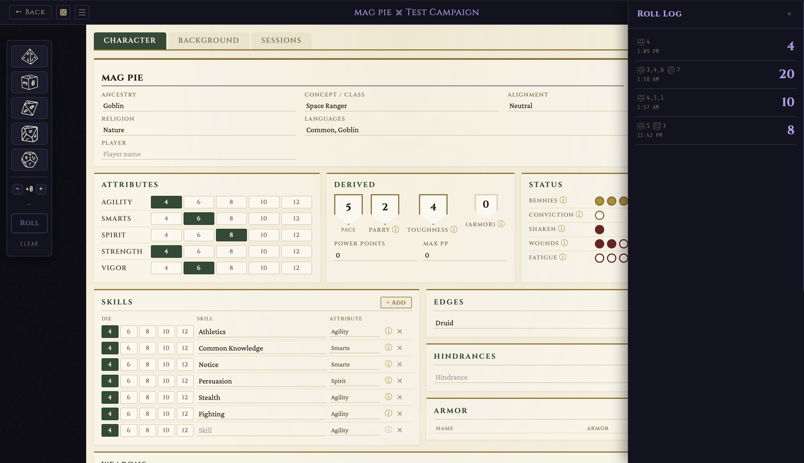
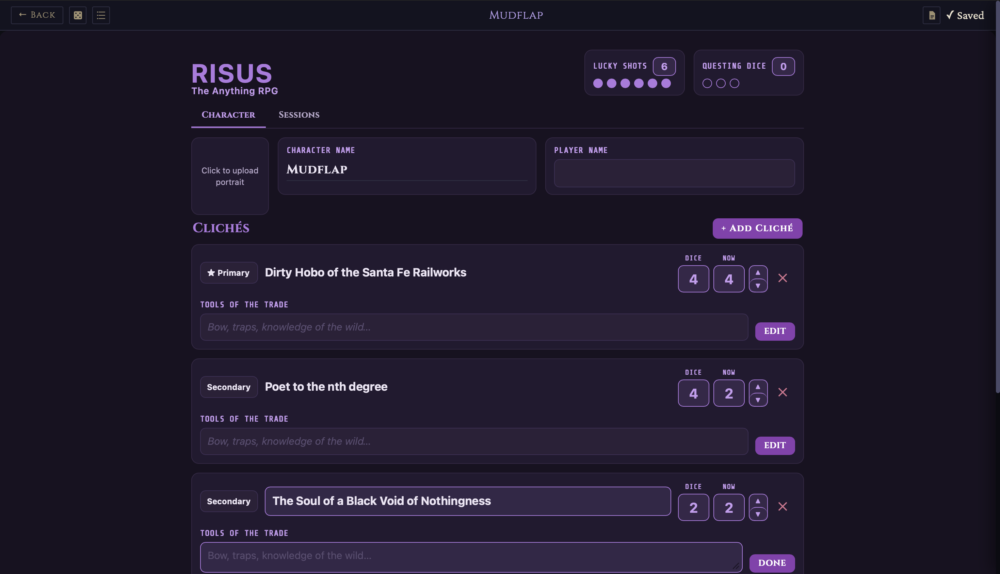
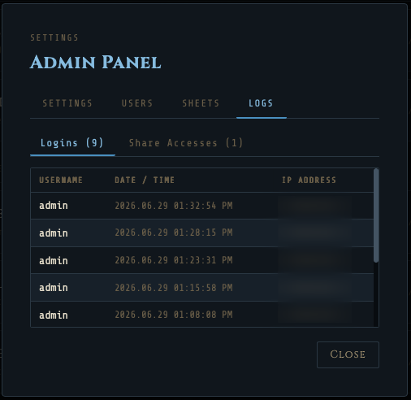
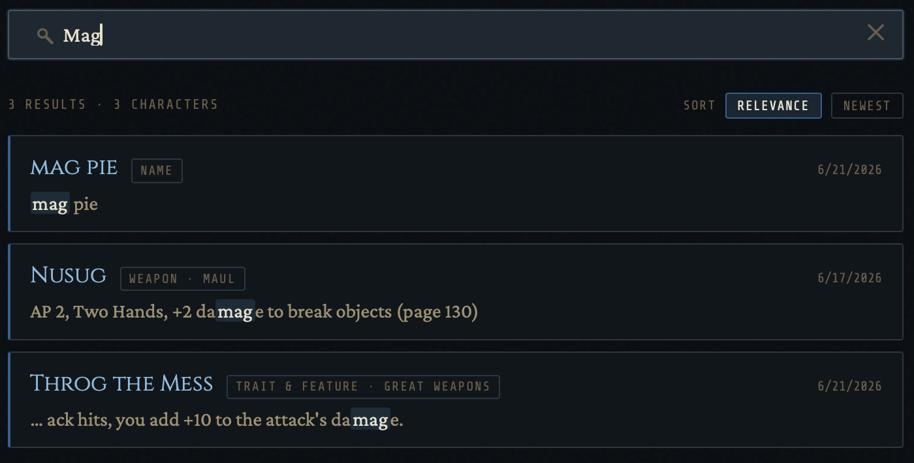
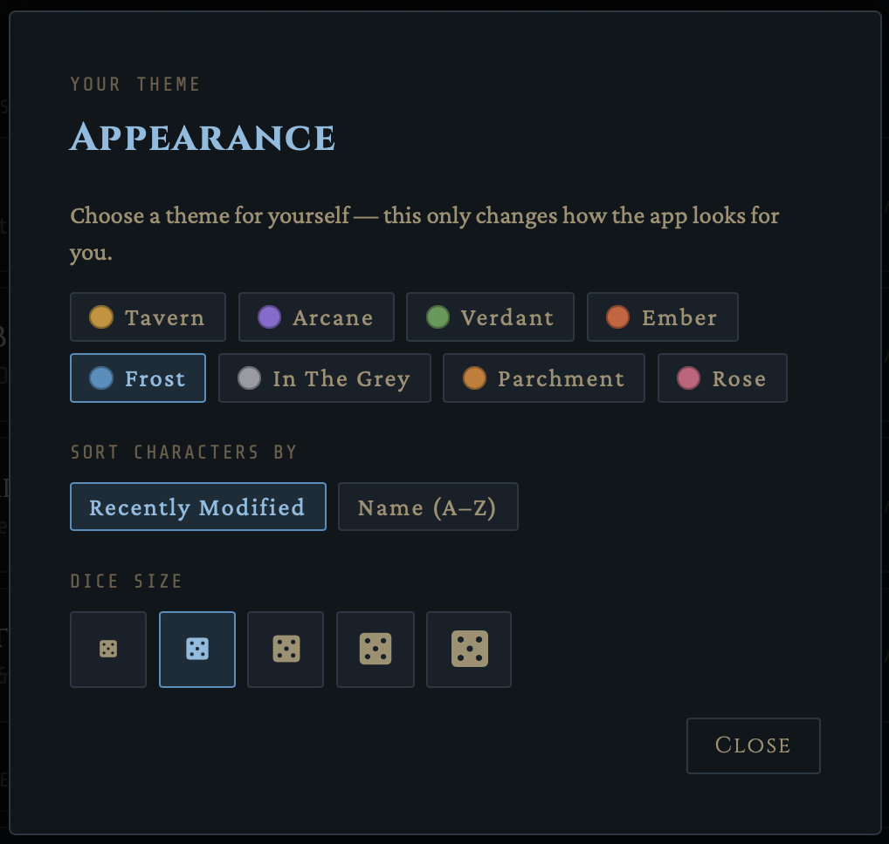

# Keep


This project is **under active development**, and you may encounter some breakage or incomplete features

A self-hosted, system (TTRPG) agnostic, character sheet app for tabletop RPGs. You run it on your own server, you keep your own data (plain JSON files, no database), and you add new game systems by dropping in a folder instead of waiting for me to write code for them.

I built this for my own table and put it out there in case it's useful to anyone else who'd rather host their own thing than rent a SaaS character vault. It's aimed at personal and smallish group use, a handful of playersn and a few GMs.

Ships with sheets for **Savage Pathfinder**, **Dungeons & Dragons 5e**, **Risus: The Anything RPG**, and **Advanced Dungeons & Dragons 2e**. The version number shows in the footer and at `/api/version`.

## A note up front: this was built with a lot of AI help

I should be honest about how this got made. I'm not a web developer, my
limited background is VB.NET and SQL, and I learn by copying something that works and tweaking it until I understand it. Pretty much all of Keep was built in long back-and-forth sessions with Claude (Anthropic's AI), with me steering the design and asking "okay, but *why* does that work" until it stuck.

So if you read the code and find a comment that explains things a little too
thoroughly, or an architecture that's more carefully reasoned than a first time web project has any right to be, that's the collaboration showing. I'm putting this in the README because I think it's the honest thing to do, and because it might be encouraging to other hobbyists: you can build something real this way, as long as you stay in the driver's seat and actually learn the thing rather than just pasting whatever comes out.

Just know the design decisions are mine.

## What it does

- **Game systems are "bundles," not hard coded.** A bundle is just a folder with four files (layout, fields, styling, metadata). Drop it into the `bundles` directory, refresh, and the system shows up. Adding D&D 5e didn't require touching the app. New system = new folder, not a new release. I designed it this way to encurage community growth of the sheets. Im sure people with better ideas or more skills then me can come up with amazing sheets to share with others. 
    - **HTML-template sheets.** A bundle's layout is plain HTML wired to live data through `data-*` attributes. A single recursive renderer reads those attributes and binds them to state, so there's no custom React component per game.
    - Here is a place to share: [Character Sheet Bundles](https://github.com/CDubs00/character-keeper/discussions/15)
- **Roles and visibility.** Every account is some mix of `admin` / `gm` / `player`. Players see their own characters. GMs see characters tagged to campaigns they run. Admins see the user list and settings.
- **Campaigns with join codes.** A GM makes a campaign and gets a short human code. Players opt in by tagging their own character to that code — nobody gets pulled into a campaign without their say-so. Once added, the GM of that campaign has read access to that character, and all characters part of that campaign are grouped. If the campaign is linked to a **world**, joining it also opens that world to the player (see [Worlds](#worlds-the-keep-module)).
- **Worlds — a GM world-building surface ("Keep").** A GM-owned space for building and tracking worlds: lore, locations, NPCs, factions, deities, an in-world calendar with an events timeline, and more, laid out as a three-panel wiki. It reuses the same auth, theming, storage-as-plain-JSON, and drop-in-folder philosophy as the character side. Worlds link to campaigns, so **joining a GM's campaign opens their world to the player** at a read (or higher) tier. Still growing (system-specific reference content — spells, stat blocks — comes later), but world/lore authoring, player read access, and the calendar are real and usable today. See [Worlds (the "Keep" module)](#worlds-the-keep-module) below.
- **Share links.** Generate a public read or read/write link for a single
  character, with an experation you pick. No login needed to open it. Editable links autosave just like the real sheet.
- **Global search.** Search across every character you can see — including their session notes, from one box. It respects the same visibility rules as the roster, so it never surfaces a sheet you aren't allowed to open. Searchable fields within the sheets are dicated by the Bundles author. 
- **Dice + a roll log.** Bundles can dicate visible die types in the dice tray otherwise the standard [d4, d6, d8, d10, d12, d20, d100] will apply. Also avaliabe is a Dice Command bar, that allows the user to roll dice via notation with expanded logic (i.e. Exploding, Drop Low/High, Multiroll with seperate totals). Every throw gets logged per character (newest first, last 50 kept) so you've got a little history of how the dice have been treating you. 
- **Dice macros.** The tray pages: page one is the dice, and after it come macro pages of named one-tap rolls. Hit Edit, tap an empty slot, give it a name and a roll notation ("Sword Attack" / `2d6+3`), and from then on one tap rolls it and logs it under its name. Add as many pages as you like with as many or as few macros on each as you want. Macros are per character and need no bundle support — any bundle with dice enabled gets them.
- **Session notes.** Date-stamped notes that live with the character (in their own file, so they don't fight with autosave). A bundle turns them on by declaring it in its schema.
- **Portraits.** Per-character image upload that gets cleaned up on delete and follows the character on rename.
- **File attachments.** Keep handouts, backstory PDFs, a loot spreadsheet, or a map alongside a character. Markdown files visualize using *GitHub Flavored Markdown (GFM)*. If the attachment is a .txt or .md file users can edit dirently in app. This feature is off by default; an admin turns it on in the admin panel. There's real security work behind this one.
- **Export.** Download a character as a file. If it's just the sheet you get raw JSON, a image of each tab, a selfcontained HTML file and session notes, if any, are exported as markdown. If it has a portrait or attachments you get a tidy ZIP with everything, attachments restored to their real filenames.
- **Archive and life-status.** Characters can be `active`, `inactive`, `deceased`, `retired`, `shelved`, or `archived`. Any character that is not `active` drop into collapsible sections instead of cluttering the roster, you can change status or restore anytime.
- **Admin panel.** Create users, toggle roles, reset passwords, delete accounts, see user session logins and set app-wide settings (default theme, whether external links are allowed in sheets **and worlds**, whether attachments are active).
- **Themes.** Seven app themes — Tavern, Arcane, Verdant, Ember, Frost, In The Grey and Rose. Each user can pick their own; the admin sets the default for shared pages and new accounts. A bundle's own sheet styling is separate from this.
- **Installable (PWA).** Manifest and icons, so it can live as an app on your phone or desktop.

#### Desktop





#### Mobile


#### Others









## Dice Command-bar rolls

Typed notation now triggers physics dice plus full modifier math. Live in the Roll Log panel: type something like `2d20kh1+5`, press Enter, dice tumble on screen, total resolves with all modifiers applied. The notation string is logged as the roll's `source`.

### Notation supported

| Category | Syntax | Description |
|---|---|---|
| Keep/Drop | `kh` `kl` `dh` `dl` N | Keep/drop highest/lowest N dice |
| Reroll | `r` `rr` N | Reroll N once / recursively |
| Explode | `x` `xo` `x`N | Explode on max indefinitely / once / up to N times |
| Successes | `cs` `cf` `df` >=N | Count successes/failures, deduct failures |
| Bounds | `min` `max` N | Clamp individual die results |
| Fate | `dF` | Fudge dice (-1, 0, +1) |
| Multi-roll | `/` | Roll segments independently with separate totals (e.g. `1d6x/1d6x`) |

## Worlds (the "Keep" module)

Keep started out purely **character-centric** — you own characters, rendered from system bundles. **Worlds** ("Keep") adds a **world-centric** surface on top: a place for GMs to build and track worlds and their lore. It's a module *inside* Keep, not a separate app, and it follows the same rules as everything else — plain JSON on disk, owner-only visibility, theme variables, and content that drops in rather than being coded in.

A GM **owns** their worlds and does all the authoring; an admin doesn't get to peek into another GM's world. Players get in a different way — by **joining a campaign** (see below), which opens the linked world to them read-only.

### Campaigns, worlds, and how a player gets in

Worlds and campaigns are linked, and that link is how the world stops being GM-only:

- **A campaign can belong to a world.** When a GM creates or edits a campaign, they can point it at one of their own worlds (or leave it standalone). One world can have many campaigns.
- **Joining a campaign opens its world.** A player tags their character to a campaign with its 6-character join code (the same opt-in flow the character side already uses). If that campaign belongs to a world, the player's *account* is added to that world's access ledger at the **read** tier — automatically. Access is keyed to the user, not the character, and it sticks around even if they later leave the campaign.
- **Four access tiers, set by the GM.** From the world's **Access & members** settings the GM promotes a member from **read** → **propose** → **write**:
  - **read** — browse the world (fog stripped, hidden/over-tier entries invisible).
  - **propose** — additionally suggest edits that queue for the GM to approve or reject; nothing is applied until the GM says so.
  - **write** — a trusted co-author who edits entries directly (with full version history), but still can't delete entries, manage members, or change world settings.
  - The GM can also **revoke** a user (which cascades their characters out of the world's campaigns) or **kick** a single character from a campaign without touching that user's world access.
- **The server is the only gate.** Everything a member is allowed to see is decided server-side and sent already filtered and already fog-stripped — the client never hides anything it was trusted with. Fog, hidden entries, and over-tier content simply never leave the server for a member who shouldn't have them.

- **A landing "home" page.** Opening a world lands on a GM-authored home page — free-form Markdown (with fog, wiki links, and uploaded images) that sets the scene before you dive into the lore, rather than dumping you into the first category. It's the "Home" item at the top of the rail; on a phone it's the top of the drill-down. Edit it in place; images upload to the world's own asset store.
- **Three-panel lore wiki.** Beyond Home you get a category rail (left), an entry list (middle), and a reader/editor (right). On a phone it collapses to a drill-down — you land on the home page and tap *into* depth (home → categories → entries → entry), with a back chevron, a hamburger drawer, and right-swipe-back. It's built to run a game from your phone.
- **Rename or hide categories per world.** One GM's "Deities" is another's "Powers," and a third hides "Events" entirely — a "Customize categories" panel does both, per world. It's display-only: the underlying category never changes id, so every entry and every `[[wiki link]]` keeps resolving, and the shared pack is never touched.
- **Search the whole world.** The search box at the top of the rail spans every category at once — matching an entry's name, subtitle, or any field text — not just the one you're looking at. Results show the entry, its category (with your rename), and a matched snippet, and mark anything hidden; click to jump straight there. Even entries in hidden categories turn up, so you can always reach what you authored.
- **Lore categories come from "packs," not code.** Just like sheets are bundles, lore categories are **packs** — a drop-in folder that declares categories (Locations, NPCs, Factions, Deities, Events, Organizations by default) and the fields each one carries. New categories = new pack, not a new release. The loader is defensive: a broken pack falls back to a sane default set instead of leaving a world empty.
- **Markdown authoring, the plain-text way.** Entry bodies are written in clean **Markdown** (GitHub-flavored) with a formatting bar that *inserts* the syntax — no rich-text/WYSIWYG surprises, the literal `**bold**` stays visible and editable. Bodies are always rendered as safe React nodes, never raw HTML.
- **Fog (GM-only spoilers).** Wrap text in `||double pipes||` and it renders as a "GM only" chip. Your hidden lore is visible to you at the table, but it's stripped server-side before it ever reaches a player — a read or propose member never receives the fogged text at all, and neither does anyone below the tier the GM set on the entry. (Whole entries can also be marked hidden to keep them owner-only.)
- **In-world calendar + events timeline.** A pack can declare a fictional calendar — its own months, days, eras, and epoch — and the world can then keep time in it. An "Events" category gets structured in-world dates (validated on save against the calendar), and a **Timeline** view lays those events out in chronological order with the gap between them, respecting the same visibility rules so a player only sees the events they're allowed to. In-world fictional time and real-world session dates stay separate — the calendar describes fiction only.
- **Wiki links.** Type `[[Waterdeep]]` (or `[[Waterdeep|the City of Splendors]]`) to link to another entry *by name*, across every category. Links resolve at render time — no stored link table to keep in sync. A live `[[`-autosuggest offers existing entry names (match-only). A dangling link renders in a visible "broken" style rather than silently, and a **world-level Broken-links report** lists every unresolved reference with clickable jumps to fix them.
- **Inline images + attachments.** Upload images straight into an entry's body and drop them in with one button, or keep a list of downloadable files (handouts, maps) on the entry — same "store inert, serve guarded" security model and file-type allowlist as character attachments, served app-origin only. Inline images can be **resized and left/center/right aligned** (with text wrapping around them), and can even be tucked inside fog.
- **Version history.** Every edit snapshots the previous state to a sidecar. A quiet clock icon opens a timeline you can preview and **restore** from — and a restore is itself undoable (it snapshots the current state first).
- **World backdrops.** Give a world a background image; the app mutes it automatically (a themed scrim + frosted-glass panels) so text is always readable — there's no opacity knob to fiddle with. It shows behind the wiki and as a faint banner on each world card.
- **External-link policy.** Worlds obey the same admin "Allow external links" setting as sheets: when it's off, off-origin links become plain text and the link button disappears from the format bar.

- **System reference (the stamped tier).** Lore is deliberately *system-agnostic* — a tavern is a tavern in any ruleset — so mechanics live in their own tier alongside it. Point a world at a **game system** (World settings → General) and a **System** section appears in the rail with that ruleset's own categories: for Savage Pathfinder that's Skills, Edges, Hindrances, Gear, Armor, Weapons, Powers, Special Abilities, Bestiary and House Rules. Author statblocks, edges and homebrew there and link them from anywhere with **`[[sys:Ankheg]]`**.

  The field *shapes* come from the **game bundle**, not from the app — the same `emptyEdge` / `emptyPower` templates your character sheet already uses — so a new system is a new bundle, never a new release. Every entry carries a `systemId` **stamp** recording which ruleset it was written for, which is what lets a world outlive a system: change the world's system and existing entries stay put and stay editable, while the **Links & conversion** report lists every `[[sys:…]]` that no longer resolves, **most-referenced first**, as your conversion worklist. Links resolve by *name* at render time, so re-pointing a world re-points every link at once.

  System entries obey the same rules as lore: per-entry **hidden/shared** visibility and `||fog||`, both enforced server-side — so you can write up next session's boss in the Bestiary before the party ever meets it. **Homebrew is just a House Rules entry**; it's mechanical, so it belongs in the stamped tier rather than in a bucket of its own.

**Sessions** — a per-campaign session log tied to the world — are also planned; today session notes live per-character on the character side.

Worlds are **under active development**, but the core is real and in daily use: world + lore authoring, campaign↔world linkage, tiered player access, fog, the calendar/timeline, customizable categories, and the system-reference tier all work today.

## Quick start

```bash
docker compose up -d
```

Then open `http://localhost:3210`.

On a brand-new install with no accounts yet, the app shows a one-time **setup
wizard** in the browser that creates your first admin. Once that first admin exists the wizard closes for good.

## Users

A fresh, accountless install shows the browser setup wizard at `/setup`. After the first admin exists, you've got three ways to make more accounts:

The in-app **Admin panel** is the easy one for day-to-day use.

From the command line at any time:

```bash
node adduser.js <username> <password> [--admin]
```

Or bootstrap a first admin from environment variables (handy for an unattended deploy, once the user exists it's never touched again):

```
INITIAL_ADMIN_USERNAME=<name>
INITIAL_ADMIN_PASSWORD=<password>
```

Passwords have to be at least 10 characters. I followed the modern advice
(NIST 800-63B) here: length matters more than forcing a symbol-and-a-number, so the app sets a floor and otherwise stays out of your way. Use a passphrase.

## Routes

| Path                 | Auth        | Purpose                                  |
|----------------------|-------------|------------------------------------------|
| `/setup`             | public¹     | First-run admin creation (one-time)      |
| `/login`             | public      | Login                                    |
| `/characters`        | required    | Roster                                   |
| `/characters/:id`    | required    | Character sheet                          |
| `/worlds`            | required    | Worlds list — those you own or belong to |
| `/worlds/:id`        | required    | World wiki (owner, or member read-only)  |
| `/share/:token`      | public      | Public share view (view or edit)         |

¹ `/setup` only works while zero users exist; after that it redirects.

## Adding a new game system

Systems are **bundles**, and not coded into the app. A bundle is a folder with four files:

```
<your-bundle>/
  manifest.json   metadata (name, version, author, sheetId — a UUID v4)
  schema.json     field definitions + emptyCharacter template + empty-item templates
  sheet.html      the visual layout, with data-bind / data-list / data-type wiring
  theme.css       colors, fonts, layout (scoped under a wrapper class)
```

Drop the folder into the bundles directory, then either restart the container. On startup the backend scans for bundles, registers anything new in `sheets-registry.json`, and serves it to the frontend.

A few conventions the renderer leans on:

- Plain inputs use `data-bind` on its own. `data-type` is reserved for the special widgets: `tracker`, `readonly-name`, `portrait`, and `die`.
- The character name lives at `info.name`. The new-character default lives at the top level of the schema as `emptyCharacter`.
- Repeating lists use `data-list` / `data-item`, and new rows are filled from a schema key named by convention — list `skills` pulls from `emptySkill`, list `hindrances` from `emptyHindrance`. A template value of `@today` gets stamped with the current date.
- A bundle can keep extra data in its own sidecar file (session notes do this) by declaring `"sidecarPaths": ["sessions"]` in its schema, so big optional data doesn't bloat the main character file or race autosave.
- Bundles are self-contained. Ship your fonts, backgrounds, and logos inside the bundle folder and reference them through `/api/sheets/:sheetId/assets/...` —don't reach out to the web.
- Scope your theme CSS under a wrapper class so it can't leak out into the app's own chrome. `risus-core` is the cleanest reference for getting that right.

The scanner only ever **adds** bundles. It never edits or removes an existing
registry entry, and if two bundles claim the same `sheetId`, the oldest
registration wins. Bundle file contents (schema, layout, theme, assets) are read live, so editing those just takes a reload; changing a *registered* bundle's manifest metadata needs an admin refresh to re-register.

The five shipped bundles (`savage-pathfinder`, `risus-core`, `dnd5e`, `dnd5e24`,
`adnd2e`) are working references to copy from.

## Adding a system package (the compendium)

A bundle can *also* declare a **system package** — the reference categories a world
gets when it's stamped with that system (see *System reference* under Worlds). This
is opt-in and lives in the same `schema.json`:

```jsonc
"sysrefTypes":  ["skill", "edge", "creature", "rule"],   // ORDERED — this is the rail order
"sysrefLabels": { "creature": "Bestiary" },              // optional; else pluralised from the id
"sysrefIcons":  { "creature": "bestiary" },              // optional; else a generic file glyph
"sysrefFields": {                                        // optional presentation overrides
  "edge": { "requirements": { "type": "textarea", "fog": true } }
}
```

**The rules that matter:**

- **Declare or nothing.** A bundle offers a system **only** if it declares
  `sysrefTypes`. There's no automatic derivation — without it the bundle is a
  character sheet and nothing more, and it won't appear in the system picker. Most
  bundles are sheet-only, and that's a normal state.
- **Shapes come from the `empty*` blocks you already have.** `"edge"` reads
  `emptyEdge`; a two-word id like `"magic-item"` reads `emptyMagicItem`. An Edge in
  the compendium and an Edge on the sheet are the same shape, so declaring it twice
  would only guarantee drift. `name` is implicit — don't list it as a field. Only
  scalar values become fields; a nested object is skipped rather than have the app
  invent an editor for it.
- **A system rides on a sheet, never the reverse.** A system package requires a
  registered bundle (all four files, `sheet.html` and `theme.css` included even if
  they're stubs). Nothing on the character-sheet side ever reads the `sysref*` keys,
  so adding a package cannot break a sheet.
- **Enriching an `empty*` block is safe, but check first.** These templates also
  seed new *character* rows. `sheet.html` binds fields explicitly, so extra keys
  are inert on the sheet — confirm the `data-bind`s before adding one.
- **Order is meaningful.** `sysrefTypes` renders in the order you write it; match
  the rulebook rather than the alphabet.
- **Every type needs somewhere to hide a secret.** `||fog||` only works in a
  `textarea` field, so give each type a description (or mark a field
  `"fog": true`). Otherwise a GM has nowhere to annotate a statblock players can
  read. `npm test` enforces this.
- **Author with the rulebook open.** The shapes are the product — a guessed
  statblock is worse than none, because entries authored against it have to be
  redone. Ship the schema, not the content: **no SRD or rulebook text**, only the
  structure plus a couple of obviously-invented samples if you want them.

Check what a bundle yields without touching the UI — `schema.json` is read live, so
edit and re-run:

```bash
cd backend && node -e "
const sr=require('./systemRef');
for (const t of sr.typesFromSchema(require('../bundles/YOURS/schema.json')))
  console.log(t.label.padEnd(18) + t.fields.map(f => f.key).join(', '));
"
```

Then `npm test` (in `backend/`) checks the contract: if a bundle declares a
package, every type must yield fields and a fog-capable one.

Two bundles ship as systems today — **Savage Pathfinder** (10 categories, authored
against its rulebook) and **Risus** (3). The others are sheet-only.

## Data & volumes

The container uses two mounts (see `docker-compose.yml`):

```yaml
volumes:
  - ./data:/data         # persistent app data
  - ./bundles:/bundles   # game-system bundles (BUNDLES_DIR=/bundles)
```

```
data/
  users.json            accounts and hashed passwords
  campaigns.json        shared campaign list
  worlds.json           GM worlds (the "Keep" module), owner-tagged
  settings.json         app settings (default theme, link policy, attachments)
  sheets-registry.json  generated bundle registry
  characters/<user>/    one JSON per character, plus its portrait, session notes,
                        roll log, and any attachments — all named after the character id
  lore/<worldId>/       one JSON per lore entry, plus its history sidecar and any
                        uploaded images/attachments — all named after the entry id
  packs/<packId>/       lore-category packs (seeded from the image on first run,
                        never overwritten — same as bundles)
  sysref/<worldId>/     one JSON per system-reference entry (statblocks, edges,
                        house rules), each stamped with the systemId it was
                        written for
  world-assets/         per-world backdrop images (flat <worldId>.backdrop.<ext>),
                        plus a <worldId>/ subdir per world for landing-page images
                        and attachments (asset.<key>.<ext> + assets.json manifest)

bundles/
  <bundle>/             installed game-system bundles
```

`BUNDLES_DIR` controls where bundles live; if it's unset it falls back to
`data/sheets/`. The built-in bundles get seeded into the bundles directory on
first run, and existing folders are never overwritten, so your edits and your own drop-ins stick around across updates.

Character files are plain JSON. Easy to backup and copy. That portability is on purpose, and it's why there's no database.

## Production environment

When you run this behind a reverse proxy with HTTPS:

- `NODE_ENV=production`
- `SESSION_SECRET=<long random string>`: the server **refuses to start in
  production** without it. Generate one with:
  ```bash
  node -e "console.log(require('crypto').randomBytes(32).toString('hex'))"
  ```
- `CORS_ORIGINS`: leave this **unset** in production. The backend serves the
  frontend from the same origin, so there's no CORS to configure.

`trust proxy` is on so secure cookies and real client IPs work behind a proxy
that terminates TLS.

## Development

Run the backend and frontend in two terminals:

```bash
# Backend (defaults to port 3001)
npm install && npm start

# Frontend dev server (port 3000)
cd frontend && npm install && npm start
```

There's no CRA proxy. In dev the frontend talks to the backend through two env vars:

- Frontend: `REACT_APP_API_URL=http://localhost:3001`
- Backend: `CORS_ORIGINS=http://localhost:3000` (so the dev server can send
  session cookies)

For a production-style run, build the frontend first, then bring up the container:

```bash
cd frontend && npm run build
docker compose up -d --build
```

## Security

I'm not a security professional, so I leaned hard on AI guidance here and tried to do the important things properly. What's in place:

- Helmet security headers (X-Powered-By off, HSTS in production)
- Login rate limiting
- Crypto-random share and join tokens
- Path-traversal guards on every route that takes an id, so a crafted id can't escape the user's own folder
- An image only guard on the portrait mount (closes a JSON leak vector)
- Session cookie hardening (`httpOnly`, `sameSite`, `secure` in production)
- `SESSION_SECRET` required to boot in production
- A minimum password policy (10+ chars) shared across setup, admin-create, and password reset
- Field-ownership rules in autosave: a stale open sheet can't clobber campaign membership, shares, status, or the attachment list — those are read from disk and owned by their own endpoints
- CSRF synchronizer token (env-gated via `CSRF_ENFORCE`; recommended on)
- Bundle HTML are sandboxed via an attribute allowlist, DOMPurify, CSS scoping, and off-origin resource blocking. Community bundles shared on Discord, Reddit, or GitHub are safer to install than before, but treat them with the same judgment you'd apply to any third-party code — review what you're installing, especially on a multi-user instance.

The **attachments** feature got the most careful treatment, because letting users upload arbitrary files is worrisome. The approach is "store inert, serve guarded": an allowlist of extensions (not a denylist), a magic-byte sniff so a renamed `evil.exe` → `backstory.pdf` gets caught, server-generated filenames so your original name never touches the filesystem, pinned content types with `nosniff`, and a forced download for anything the browser might try to execute. Active-content types like SVG are deliberately left off the list. There are per-file (25 MB), per-character (50 files), and total (250 MB) caps.

**Content-Security-Policy** is enforced when CSP_ENFORCE=true (report-only by default — watch the console, then flip). See .env.example for all available security toggles.

See [SECURITY.md](SECURITY.md) for the reporting process and security model.

## Security & Disclaimer

Keep is **free software, provided "as is", without warranty of any kind.** See [LICENSE](LICENSE) (GNU AGPL v3) for the full terms, including the warranty disclaimer (§15) and limitation of liability (§16). The authors and contributors are **not liable** for any damages, data loss, or security incidents arising from its use, misuse, or deployment.

It is designed to be **self-hosted for a trusted group**, not run as a public service for untrusted or anonymous users. You are responsible for securing your own deployment. In particular:

- Set a strong, unique `SESSION_SECRET` (`openssl rand -hex 32`) and never commit it. The server refuses to start in production without one.
- Run behind HTTPS (e.g. a reverse proxy) for any networked deployment.
- Set `CSRF_ENFORCE=true` and review the other toggles in [`.env.example`](.env.example).

For configuration options, see [`.env.example`](.env.example). To report a
security issue, see [SECURITY.md](SECURITY.md) — please report privately, not via a public issue.

## Roadmap

Roughly in order, dependency and time permitting:

- **Security Audit** - confirm every mutating route rejects unauthenticated and cross-user requests, and lock that down with automated tests so it can't quietly regress.
- **More Bundles** — candidates I'd like to do next include D&D 3e and Star Wars Saga Edition.
- **More system packages** — the compendium tier works, but only Savage Pathfinder and Risus declare one. The rest are sheet-only until someone works through the rulebook properly; plain Savage Worlds is the obvious next one, since it's near-identical to Savage Pathfinder.
- **Mobile layout polish** — single-column, collapsible sections on small screens.  
- **Character Ownership transfers** - Allow a user to transfer a character then own to another User/Admin. 
- **Add d2/coin-flip** - Dice-Box currently doesnt have a d2 or Coin render so I am attempting on figuring out how to add one. 

## Why it's built the way it is

- **JSON-per-character is intentional.** Easy to back up, portable, git-friendly, and there are no database migrations to dread. The files are the product.
- **The schema is the source of truth for fields.** Game-specific knowledge lives in bundles, never in the renderer. A new system should never mean new app code.
- **`window.location.origin` for public URLs.** Zero config; works the same locally and behind a reverse proxy.
- **Build one thing at a time, all the way through.** I'd rather finish a feature properly than have five half-built ones. The codebase tries to reflect that.

## License

Intended to be released as free and open source software under the **GNU AGPL
v3**. (If you're self-hosting a modified copy and exposing it to others over a network, the AGPL is the license that asks you to share those changes back, which fits the spirit of how this was made.)

## Credits

Built by me, CDubs00, with extensive help from Claude across many long sessions design discussion, code, debugging, and a running commentary that doubled as a webdev crash course. The bundles, the hosting, the stubbornness, and the bad decisions are mine; a great deal of the explaining was the AI's.

Game system content (SWADE, Savage Pathfinder, D&D, AD&D, Risus, etc.) belongs to their respective publishers. The bundles here are character-sheet layouts for personal use, not redistributions of anyone's rules.